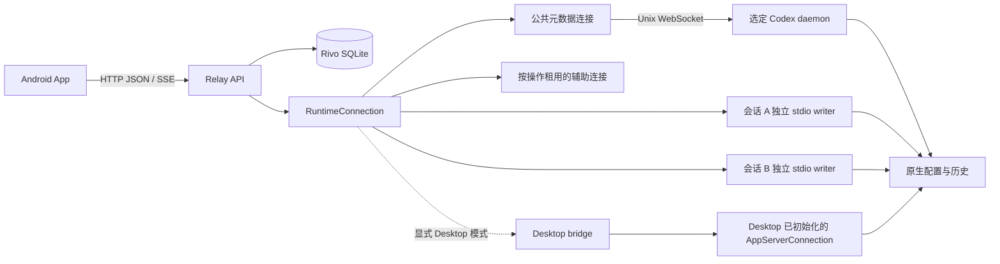

# Rivo Relay 当前架构


## 产品与系统边界

Android App 延续原生 Codex 的项目、会话、设置、审批与执行，并保留 Rivo 的节点管理、待办、草稿、队列、提醒和更新入口。不另建 OpenAI 登录、项目白名单或一套聊天历史权威；原生提问、审批和项目信任仍生效。进程级强制接管需要展示影响范围并确认，它与普通操作权限审批不同。

一个 App 当前连接一个节点；一个 Python Relay 服务使用一个 SQLite 数据库。没有中央账号、独立队列服务或跨节点执行调度。可选 VPS 网关提供远程中转，部署与连接方式见 [VPS 中转](vps-gateway.md)。单进程 Relay 可以管理多个独立会话 writer；“单进程服务”不等于全部会话共用一个原生 writer。



`RuntimeConnection` 支持 `auto`、`app_server`、`desktop`。当前独立 writer 后端声明 `sessionIsolation`，因此 `auto` 保持 app-server 路径，不会在发现 Desktop 后把 App 会话悄悄迁回共享 writer。显式 `desktop` 模式仍可使用 Desktop 共享连接。已创建或恢复的会话固定到所属后端；失联不意味着可以换连接重发。

## 技术与目录

| 部分 | 当前实现 |
| --- | --- |
| 服务端 | Python 3.11+；标准库 HTTP/TLS、SQLite；WebSocket、二维码和 Pillow 媒体处理 |
| 客户端 | 单个 Android `:app` module；Kotlin/Compose、StateFlow、OkHttp、Coil、Media3、ZXing；JDK 17、SDK 37、minSdk 26 |
| 通信 | HTTP JSON 与 SSE；原生 Unix WebSocket、Relay 自有 stdio app-server、Desktop protocol-1 bridge |
| 存储 | SQLite schema 4、事务与迁移校验；手机 Keystore 保护连接凭据，私有存储保存草稿、显示缓存和待核对提交 |
| 并发 | 有界 HTTP/SSE、逐会话 operation gate、最多 4 个队列线程、媒体重任务最多 2 个并发槽位 |

主要源码入口：

```text
server/rivo_relay/
  app.py, api.py, http_server.py  # 依赖组装、认证路由、HTTP/SSE
  routes/                       # 按业务拆分的已认证 JSON 路由及共享请求校验
  database.py, submissions.py    # 持久化、提交去重和未知结果核对
  operation_gates.py, queue.py   # 会话操作互斥、待发队列
  media.py, speech.py, todos.py  # 媒体、语音、待办
  codex/
    runtime.py, connection.py    # 后端路由、RPC、通知与连接代际
    owned_writer.py, writers.py  # 独立 writer 生命周期、进程身份与交接
    desktop.py, desktop_host.cjs # Desktop bridge 客户端和宿主模块
    sessions.py, interactions.py# 会话、设置、请求和审批
    history.py                  # 官方分页与严格协议校验
    native_journal.py           # 日志水位核验、读取作用域和收敛
    native_history_host.py      # 实际原生主机上的增量日志检查
    native_reprojection.py      # 隔离重建与发布前复核
    projects.py, files.py        # 项目、节点文件与传输
client/android/app/src/main/java/dev/rivo/relay/
  App.kt, AppState.kt            # 节点与页面生命周期
  connection/                   # 配对、节点凭据与网络状态
  data/                         # API、模型、缓存、媒体与更新
  codex/
    NodeSessionSync.kt          # 一个节点事件流、并发快照读取合并
    SessionController.kt        # 会话校准、增量、分页和控制状态
    CatalogState.kt             # 项目与会话目录
  ui/{theme,login,projects,sessions,chat,todos}/
```


## 登录、节点与传输

无已登录节点时展示登录授权；已有节点恢复项目页。电脑 CLI 生成有期限的一次性配对码，二维码 fragment 不携带原生登录凭据或长期 token。服务在同一事务中消费码并创建连接，只保存配对码和 token 的摘要，实行来源及全局有界限流。

普通离线保留登录；认证失败清除失效连接并回到授权。撤销连接由服务端执行，HTTP 与已有 SSE 都重新验证授权。本机删除保存的凭据不等于撤销服务端连接。

服务默认监听 loopback，非 loopback 监听要求 TLS。本机主节点使用 `http://100.124.150.1:18767`，经 tailnet TCP 转发到 loopback 18765；Android 对该明确 IP 开放 HTTP，其他节点仍要求受信任 HTTPS。节点通过显式配对添加，不自动迁移地址或向其他节点复制凭据；已有 `storageBase` 继续用于隔离草稿、缓存和提醒。请求日志不记录 Bearer、配对链接或正文。

默认网络改变时，`RelayApi.resetTransport` 在 IO dispatcher 取消旧 GET/SSE、重建连接池并关闭空闲连接；已发出的写请求不因此取消或重发。会话转为 stale，恢复后重新订阅和校准。服务 HTTP worker 按连接占用，不能只移除关闭响应头就宣称具备合适的长连接调度。

## 独立 writer、辅助租约与 Desktop

### 公共连接和会话连接

`SessionWriters` 包装选定的既有 daemon 连接。公共连接只承担允许列表中的元数据、目录、模型、账户、配置和文件查询；`thread/read` 只有 `includeTurns=false` 才可直接走公共连接。它不执行 `thread/start/resume/fork`，也不隐式执行 turn、review、设置或 goal 写操作。

创建、fork 或首次 resume 使用新的 `OwnedWriter`，启动已核实的 Codex 可执行文件 `app-server --stdio`，使用相同 `CODEX_HOME`，并建立独立进程组。启动依据实际本机 socket/进程身份；转发 socket 或探测到远端 home 不足以授权在 Relay 本机创建 writer。thread ID 与返回身份不符、连接已换代或创建结果不确定时，关闭未能登记的子进程，禁止留下无人管理的 writer。

一个由 App 执行的会话固定使用自己的 writer。发送、排队派发、审批响应、重连后的核对和恢复不能借用另一个会话的 writer。审批 key 包含实际 writer generation 和原生 request ID；释放、断连、turn 结束或原生请求已解决后，旧审批不能再次回答。公共连接重连不会把仍存活的会话 writer 一并判死。原生权限、提问和支持的 MCP 表单由手机展示；需要 Desktop 注册签名凭据的 userVerification 仍留在 Desktop 完成。

公共允许列表之外的辅助操作需要独立的临时连接。`auxiliary_connection()` 将其租给一次完整操作并在 `finally` 关闭；上传等多步流程可以持有同一租约，不借用活动会话 writer。显式 Desktop 后端没有独立 stdio 租约时使用其桥接连接，并核验后端 generation。

### 逐会话释放与进程级接管

自有 writer 的释放先核验首条历史已持久化，设置持久释放栅栏，阻止队列和自动恢复；再尝试停止该会话任务，关闭对应 writer 及其进程组，最后检查真实 OS 写锁。停止 RPC 被拒绝或超时不能省略关闭和锁核验。只有核验通过才报告释放完成；失败保持 `release_pending`/不可操作状态，不能把 `released` 标志当成 OS 已解锁的证据。

未持久化的空会话不能贸然释放创建连接。首轮已被原生接受而 rollout 尚未出现时，有限期使用真实创建/turn 回执展示状态；超过等待边界后进入核对，而非再次伪装为空会话发送。

外部 writer 的显式接管与关闭自有 writer 是不同流程：预览 PID、启动身份、关联会话和进程影响范围，生成绑定授权连接的短期票据；执行前重新核验，必要时终止经过核实的持锁进程，确认锁释放后恢复目标会话。多会话范围需要整体取得 operation gates，受影响队列保持暂停。普通排队不会自动抢占外部 writer，也不会重发原任务。

Desktop bridge 共享 Desktop 已初始化的 `AppServerConnection`，不是启动另一个 Desktop 原生进程。宿主必须加载 `desktop_host.cjs`，桥接 socket、token、owner 权限及协议握手必须有效；代码存在不等于当前宿主已经可用。Desktop 的“释放订阅”仅解除 Relay 对共享连接的订阅，不代表关闭 Desktop 或释放其 OS 写锁；共享 Desktop 不走结束进程式强制接管。

### 操作并发边界

`ThreadGates` 使用可重入的逐身份锁，包含等待者引用计数，最后一个使用者离开后移除条目。会话发送、释放、恢复、设置等协调操作与执行队列共用同一 `operation_gate`，同一会话的派发与队列变更保持顺序。审批回复另在所属 writer 的线程锁下核验请求和连接代际，不依赖公共连接。跨会话交接对完整作用域去重排序后加锁，避免锁顺序相反。创建使用 project 作用域，其他会话可以继续处理。

共享映射仍使用短时锁保护，数据库仍受 SQLite 事务约束；并发范围的改变不等于所有 RPC 可以同时修改一个会话。

## 原生历史、收敛与双 revision

已完成正文、thread/turn/item 身份及分页仍来自官方历史 RPC。Relay 的日志检查只提供生命周期水位、文件身份和收敛依据，不把 rollout 正文转换成第二份 App 聊天数据库。

`NativeJournal.read_scope` 为一次读取固定实际后端与 generation；`NativeHistoryAdapter.read_scope` 在该请求内共享已经校验的 head/page，使收敛检查和响应可以使用同一次官方分页读取。作用域结束即丢弃，不是跨请求的历史响应缓存。

日志检查缓存按实际连接 generation 和 thread ID 隔离，最多保存 128 项。文件 fingerprint 包含 device、inode、size、mtime、ctime；身份完全未变时复用生命周期解析结果，但重新核验 writer lock。未压缩文件追加时，从完整记录边界增量 JSON 解码，同时重新计算整个旧前缀的摘要，检测同 inode 中段被改写后再追加的情况。因此优化的是重复 JSON 解码，旧前缀字节校验仍为 O(n)，不能描述为只读新增字节。截断、替换、模式变化、压缩文件变化或前缀不符回到完整检查；未完成的尾记录属于写入中状态，不能据此启动修复。

日志与官方投影不一致时，收敛层判断是否可重建。修复使用已核实的原生主机和 Codex 二进制，在独立临时 home 中运行官方投影重建；持有真实 writer lock，核验原文摘要和历史段身份，在发布前再次检查锁文件身份及源数据未变。活动 Desktop/CLI writer 不会为普通历史读取而被释放；无法核验时保留 unavailable/converging 状态，而不是声称历史已经修好。

返回两个用途不同的 revision：

- `nativeRevision` 是分页有效性标识：包含连接/修复 generation、日志结构 epoch 和最近两轮结构。执行中的正文追加不使旧分页 cursor 失效；新增/删除 item、轮次终态、回滚、历史重写、修复或连接变化仍会改变它。终态内容的纠正也参与校验。
- `nativeHeadRevision` 包含最近 head 的实际内容，用于区分实时内容变化。它不能替代分页校验用的 revision。

更早页面携带预期 `nativeRevision`；不匹配或正在收敛时拒绝混合。Android 先发布新的可信 head 和控制状态，再独立恢复之前已展开的历史深度。历史补页只合并历史，不能覆盖后来更新的审批、writer 控制或实时状态；所有结果还要通过页面 generation、history/control epoch 和快照身份检查。

## 提交、事件与客户端状态

写请求先生成稳定 `submissionId`，持久记录固定目标。服务先 commit claim 和正文摘要再调用 Codex；相同授权连接、ID、目标和正文复用结果，变更正文或目标返回冲突。`accepted` 只表示原生接受；失去回执或中断进入 `unknown`，不自动重发。跨 SQLite 与原生 RPC 不宣称 exactly-once。“结束核对”只解除手机等待，不取消原任务或删除服务端记录。

服务 SSE 使用有界缓冲和 epoch/cursor。首连、无效 cursor、缓冲缺口或服务重启触发 reset，客户端重新读取权威状态。节点事件流不按客户端 threadId query 做服务端过滤，消费者按会话归属处理。

`NodeSessionSync` 在当前节点内共用一条活跃 SSE 订阅，供聊天与任务提醒消费者使用；无消费者时停止。对同一 thread、同一同步 epoch 的并发 GET 共用正在执行的 Deferred，所有使用者离开后取消未完成请求。前台控制校准还检查请求开始时间，不借用校准之前已经等待的旧 GET，保留原有超时保护。完成结果不作为后续请求的缓存；事件、断流或显式失效推进 epoch，避免把事件前读到的结果交给事件后的读取。

JSON GET 区分 30 秒无数据进展与 120 秒总时限，会话及后台提醒读取使用同一总时限；持续传输大历史不再因固定 10 秒期限失败。前台响应超过 3 秒仍将控制状态标记为 stale，只有完整快照通过代数和身份校验后才恢复操作。写请求继续使用独立传输设置，不因读取超时而重发。

原生相邻文本通知可在服务端按连接代际、thread、turn、item 和方法合并；结构通知是顺序边界，单合并块有大小限制。`relayOffset` 表示追加前 Unicode code point 数，客户端核验重复、重叠和内容一致性，不能对截断后的文本计算该偏移。

Android 每 150ms 或积压到 128 条时批量应用增量，结构/结束事件及时冲刷。快照解析、活动/时间线投影和增量批处理放在 Default dispatcher，使用消息索引和不可变的新消息，未变化消息保留引用；草稿、显示缓存和提交恢复数据通过 IO 路径读写。只把通过当前会话/epoch/快照检查的结果发布到 StateFlow。未知 item、位置不符、读取交叠、重连、reset 和终态仍回到官方校准，显示增量不写入原生历史。未知工具状态按未知显示，不能推断为成功。

## 队列、待办和恢复

`queued_tasks` 仅保存 Relay 接受的待发输入，原生 turn 仍是执行权威。入队读取元数据，不因此获取 writer；稳定提交 ID 防重复入队，编辑使用 revision，排序核对完整预期顺序，已撤销连接不能自动派发。

调度器通过最多 4 个 worker 检查不同会话，每个 worker 先取得同一套会话 gate。一个会话严格按队头派发：调用前持久化 `dispatching`，成功后记录 turn ID，原生完成后继续；失败或未知结果阻断后续任务。服务重启把未确认的 dispatching 转为 unknown，不重发。关闭先停止新派发，等待已接纳的调用和回执处理完成，再关闭底层资源；一个慢会话不会独占所有会话的调度锁，但一轮仍等待已提交的检查完成。

待办支持 CRUD、子任务、截止日期、重复、节点文件、原生会话关联和本机提醒。离线 outbox 成功同步后才派发。新会话交付顺序为 `claim → create → checkpoint(threadId) → link → send`；已有/未确认交付不得自动再创建会话。turn 完成不会自动完成待办。

## 消息渲染与图库派生

Markdown 语法结果与主题颜色分离，正文、图片引用提取和图库发现共用解析规则与缓存。缓存同时限制输入总字符数和条目数，解析不持有缓存锁。长文本解析转到 Default；结果属于当前内容 revision，旧任务取消后不能覆盖新消息，并定期检查取消。

链接目标、code span、文件引用及强调等试探扫描采用随输入长度增长的预算；裸 URL 尾部括号修剪使用线性计数。预算耗尽时显示完整原文并提示格式回退，不静默丢正文，也不把代码块中的图片例子变成媒体请求。完整 Markdown 不是必须全部保留格式才能显示的前提；复制、引用与链接边界仍分别校验。

外层聊天用稳定 key 的 LazyColumn。大表格初次显示 24 行，活动组初次展开 16 项，继续按钮逐批增加，不引入无界嵌套纵向 LazyColumn。表格保留完整源文本用于复制和引用；长工具输出可以继续展开及复制完整内容。展开身份与已显示批次跟随相应消息/活动组，追加内容不重置已经展开的部分。用户主动展开全部之后，布局成本仍与已经显示的内容量有关。

图库缓存限定在节点/会话生命周期内，按 turn/item 身份和不可变消息内容复用图片引用，移除不再保留的历史条目。素材同时按原生身份和 source/originalUrl 建索引；派生图库在后台计算，输入框等无关重组不重新解析整段历史。请求媒体库的 key 来自生成图片身份、状态和来源，不再使用任意 `nativeRevision`：无生成图片不请求，待导入素材继续限频查询，切换节点/会话取消旧工作。

## 文件、媒体与语音

节点文件经过选定原生主机的 FS/传输能力读取，不把远端路径当 Relay 本机路径打开；`content://` 仍是手机 URI。文件预览、下载/上传与媒体代理各有大小和格式边界，不能把文本预览 4 MiB 上限误认为所有传输都只能到 4 MiB。大文件使用流式传输，媒体 HTTP 支持条件请求及范围读取。

`MediaService` 按来源/缩略图身份合并同资源操作；下载、原生读取和解码不持有全局 cache lock。两个媒体处理槽位限制重任务，繁忙返回可识别的 429。短锁仅保护发布、索引和淘汰；临时文件、正在处理和准备交付的文件有 pin，原子替换后再发布 manifest，淘汰跳过使用中的资源。

媒体响应先打开不可变文件描述符，使用该描述符的 fstat、ETag 和范围信息发送，不在发送时重新打开可能被替换或删除的路径。媒体库文件校验缓存同时包含文件身份、尺寸、时间和声明摘要；文件改变时重新核验。原生媒体缓存 key 包含连接 generation，远端公开媒体遵守地址/大小校验；持久媒体库与可淘汰代理缓存分开。

Android Coil 使用鉴权隔离的缓存 key、有界内存缓存和解码尺寸；图库/预览保留节点身份，编辑导出、远端 base64 解码等重工作在 IO/Default。取消或失败的编辑导出清理未交付临时文件。Media3 播放器随页面释放，后台暂停。语音录制、转写及相关交互已进入当前实现，不再沿用早期“排除语音输入”的描述。

## 数据、部署与验证边界

SQLite schema 4 保存配对、连接、提交、待办、队列、观察和工作树登记；新增查询索引不改变其历史权威边界。媒体库、派生缓存和手机草稿不等于复制一份原生已完成聊天数据库。手机缓存不能复用旧审批或过期分页身份，未联网确认的缓存页面禁止原生写操作。

主节点更新源、APK 更新检查和签名发布有独立流程；部署 Relay 不应顺带重启用户的 Codex 原生运行时。协议单元测试、模拟器交互、真实节点执行、Desktop UI 双向交接分别验证，不能互相替代。本文不将代码存在、单元测试或局部基准写成当前设备已完成验收的证据。
