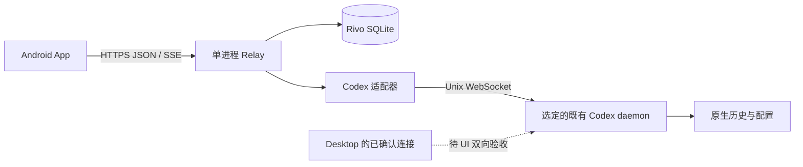

# Rivo Relay 当前架构

更新：2026-10-29。本文描述已实现结构；验收状态和缺口见[开发计划](development-plan.md)，HTTP 字段见[API](API.md)。

## 产品与系统边界

App 的目标是 Codex Desktop 的完整延续，范围是 Codex 与待办。共用原生登录、项目、会话、设置和权限，不设计独立项目白名单、设备权限等级或 App 额外审批。Desktop 不要求确认的操作，Relay 不再加一层确认；原生提问、审批及项目信任行为保持有效。

一个 Android App 连接一个当前节点；一个 Python Relay 进程使用一个 SQLite 数据库。没有中央账号、云中转、微服务或离线同步平台。0.1.4 按栖光交互补充单进程持久待发队列，不引入独立队列服务。writer 与并发由原生运行时和服务内部协调，日常界面不要求用户管理执行权。



当前实现只连接指定的既有 daemon。真实双原生客户端已验证相同 runtime/thread/turn 与执行通知；这不能替代 Desktop UI 验收。当前电脑的 Desktop 本地 stdio 与默认本地 daemon 是不同进程；远端验证节点的连接证据见[原生验证记录](native-validation.md)。状态接口保留 `desktopShared=null` 与 `requires_desktop_confirmation`，没有声称已经实现所有场景的无缝迁移。

## 技术与目录

| 部分 | 当前实现 |
| --- | --- |
| Python | 3.11+；验证环境 3.13；标准库有界 HTTP/TLS、SQLite，`websockets==15.0.1`、`qrcode[pil]==8.2` |
| Android | 单个 `:app` module；Kotlin/Compose、StateFlow、OkHttp、ZXing；JDK 17、SDK 37、minSdk 26 |
| 通信 | HTTP JSON 读写与 SSE 通知；原生接口为 Unix WebSocket JSON-RPC，不启用 stdio fallback |
| 存储 | SQLite WAL/FULL、事务与 savepoint；Keystore AES/GCM 加密手机连接凭据及未确认提交标识 |
| 并发 | 默认 16 个 HTTP worker、最多 4 条 SSE；有界 512 条内存事件；workspace 独占 `serve.lock` |

```text
server/
  pyproject.toml
  rivo_relay/
    __main__.py          # serve / pair / connections / revoke
    config.py            # 地址、TLS、workspace 与原生 socket 配置
    app.py               # 依赖组装、提交和待办交付协调
    api.py               # JSON 路由、认证、SSE
    http_server.py       # 有界 HTTP/TLS worker 和关闭
    database.py          # 七表 schema 4、旧版本迁移、事务与版本校验
    pairing.py           # 一次性配对、摘要令牌、限流、撤销
    submissions.py       # 持久 claim、身份 checkpoint、去重和核对
    todos.py             # CRUD、完成状态与原生 thread 关联
    queue.py             # 每会话待发任务、排序/编辑/撤回/引导与顺序派发
    events.py            # 有界 SSE 缓冲及 epoch/cursor
    codex/
      connection.py      # 既有 daemon 连接、RPC、通知、generation
      projects.py        # 原生项目与根路径
      sessions.py        # 创建/resume/发送/引导/停止/设置与临时增量
      history.py         # 原生分页、严格身份和 item 校验
      interactions.py    # 原生请求归属、过期与一次回答
      files.py           # 经原生 RPC 读取节点文件
  tests/                 # 隔离测试与脱敏原生 fixture
client/android/
  app/src/main/java/dev/rivo/relay/
    MainActivity.kt, App.kt, AppState.kt
    connection/          # PairingParser、PairingRepository、CredentialStore
    data/                # RelayApi、Models
    codex/               # CatalogState、SessionController、SubmissionCoordinator
    ui/{theme,login,projects,sessions,chat,todos}/
  app/src/{test,androidTest,debug}/
scripts/
  run-server.sh, verify-service.py, verify-emulator.sh
  qr-emulator-camera.py, emulator-camera-pose.py
docs/
workspace/               # 忽略的运行数据、私密配对文件、验证附件
```

旧 `android/` 草稿已整理到 `client/android/`，不维护重复工程。服务除 `codex/` 外按能力用文件组织；客户端由 `AppViewModel` 管登录/节点生命周期，各 catalog、session、submission、todo controller 管自己的状态，不引入多 module 分层。迁移来源与删改见[迁移清单](migration-plan.md)。

## 登录和连接

无已登录节点 → 节点登录授权；已有登录节点 → 项目列表 → 项目会话列表 → 会话。授权首页按本产品要求新增，已登录项目列表和后续浏览沿用 QiGuang 布局。

电脑本地 CLI 生成默认 5 分钟有效的一次性配对码。QR 的 URL fragment 包含版本和码，不含原生登录凭据或长期 token；扫码与手动输入共用解析器与兑换接口。服务在同一 SQLite 事务中消费码并创建连接，存储的只有码和随机 token 的摘要。来源地址及全局尝试有界限流；内存限流窗口在服务重启后重置，码的到期/消费状态仍持久化。

App 用 Keystore 保护连接凭据，重启后直接恢复项目页。普通离线保留登录；认证失败清除本地连接并回到授权页。撤销通过电脑 CLI，HTTP 每次认证，已有 SSE 在读取事件前后重新认证并退出。本地“断开”仅删除手机保存的凭据，不等于撤销服务端连接。

服务默认监听 loopback；非 loopback 必须配置 TLS。正式地址用受信任 HTTPS，不关闭证书或 hostname 校验。debug App 仅允许指定本机/模拟器地址的 HTTP；release 不继承该例外。请求体、Bearer 与配对链接不进入服务请求日志。

## 原生 Codex 接入

`NativeConnection` 初始化已有 daemon 并读取 diagnostics，使用独立 JSON-RPC reader 和通知 dispatcher；关闭 Relay 仅关闭自己的连接。没有启动 runtime、杀 writer、修写 rollout 或接管用户进程的代码。QiGuang Desktop bridge 缺少宿主，未作为产品入口迁入。

项目读取使用 `project/list`、`project/read`，新项目使用 `project/create`；会话依据原生 `projectId` 和精确根路径归属，无会话项目仍展示。resume 不覆盖模型、工作目录、审批或 sandbox；新建传项目根路径或用户选择 ref 后创建的独立工作树路径。发送在用户选择时传 model/effort；0.2.0 的讨论模式显式选择原生 Plan 并降低为只读 sandbox，退出该模式时恢复先前记录的权限。审批策略仍沿用原生设置。

thread/turn/item 身份与已完成历史来自 Codex 分页。未落盘的新建空会话暂保留 `thread/start` 元数据，首轮必须由创建连接发送；结果不确定后不会继续伪装为空会话。首轮已有原生接受回执、但 rollout 尚为空时，最多 30 秒用创建元数据与真实 turn 回执/通知展示执行状态，随后以原生分页为准。临时消息通知只在内存；计划、用量、变更摘要和已观察的模型设置单独保存为有界派生数据，不成为第二份原生历史。

提问与审批 key 绑定连接 generation 和原生 request ID；断连、turn 结束或 `serverRequest/resolved` 使其失效。回答前先移除本地 pending，避免丢失回执后重发。手机提供提问、命令/文件审批、原生权限请求和常见嵌套 MCP 表单/URL 交互；未知 schema 与 userVerification 签名挑战仍需 Desktop。语音输入按用户要求排除。

`GET /v1/files` 经该 daemon 的 FS RPC 读取节点文件，不用 Relay 本机打开远端路径。它属于原生节点级文件访问，没有 thread sandbox 参数，也没有 Rivo 额外项目白名单。预览解码后上限 4 MiB；当前协议没有范围读取，这只是响应大小限制。服务接收原生 text/image/localImage/mention/skill 输入，HTTP JSON 上限 8 MiB；`content://` 不是节点路径。

## 提交、增量与待办

App 写入前生成稳定 `submissionId`，持久保存 ID 和固定目标；OkHttp 不自动重试写请求或跟随重定向。服务先 commit claim 和正文摘要，再调用 Codex，只保存原生身份回执。相同连接、ID、目标和正文返回原记录，不执行第二次；变更请求复用 ID 返回冲突。`accepted` 仅表示原生接受，不代表任务完成；调用中断或缺少回执为 `unknown`，服务重启把旧 `pending` 转为 `unknown`，均不自动重发。跨数据库与原生调用之间不声称 exactly-once。核对接口只查询持久状态，不自动推断 native 结果；App 可打开已知原会话，用户明确确认“结束核对”后仅解除本机等待并清除旧回调，不取消/重发原任务、不删除服务记录。

SSE 是有界内存通知，事件 cursor 带服务 epoch；首连、无效 cursor、缓冲缺口或重启返回 `reset`，客户端重新读取原生快照。当前 Android 启动订阅并用通知触发合并后的快照读取，也定时刷新；并非每条 delta 直接绘制到 UI。切换会话取消旧任务，分页结果按当前 generation 检查，消息按原生 ID 合并。SSE 目前为已认证节点的事件流，服务不按 `threadId` query 过滤；客户端通过选定会话快照保持目标一致。

待办支持 CRUD、子任务、截止日期、重复、节点文件引用与 Android 本机提醒，离线修改进入手机持久 outbox；派发前先同步成功。新会话交付顺序为 `claim → create → checkpoint(threadId) → link → send`。已完成事项或已有关联/未确认/已接受交付时，拒绝新派发；失败前没有创建 thread 才允许显式新提交。发送已有会话前核对其属于选定项目。关联回执不丢弃，turn 完成不自动完成待办。

## 数据和验收边界

SQLite schema 4 保存配对码、连接、提交、待办、待执行队列、原生观察与 Relay 工作树登记。待发队列保存输入，提交去重表仅保留摘要与轻量身份；没有复制原生已完成聊天数据库、OpenAI 密钥或持久事件流。Android 私有文件另存草稿、有界显示缓存与待办 outbox；缓存历史不保留过期审批或可重用分页身份，未联网确认的缓存页禁用原生写操作。运行目录和验证附件被忽略，QiGuang 的库、sidecar 与部署配置没有迁入。

服务/协议测试、模拟器真实相机与原生执行、Desktop UI 人工验收分别记录，不能互相替代。Desktop UI 自动化受工具明确限制，剩余双向交接需用户协助；正式发布、签名、后台驻留和升级另行处理。

## 会话置顶与执行队列（0.1.4）

长按会话可置顶/取消置顶；列表置顶项优先。置顶读取原生 `thread.section`，写入 `thread/section/move` 的 Pinned 分组，与栖光使用同一原生元数据，不另建置顶表。

任务进行中、存在待发项或会话暂由其他运行时持有时，发送入口显示“排队”。队列在输入框上方默认展示三项，可展开、长按拖动排序、编辑正文、撤回，当前可执行的活动 turn 可接受“引导”。编辑保留附件和模型设置。队列显示执行中和结果待核对状态，失败或不确定结果阻止后续自动执行。

`queued_tasks` 保存 Relay 自己接受的待发输入，原生 turn 仍是执行和历史权威。单 worker 轮询原生快照，空闲时提交一项，收到原生完成状态后继续下一项；调用前先持久化 dispatching，重启将其变成 unknown，不自动重发。稳定提交 ID 防止重复入队；编辑用 revision，排序用完整预期顺序做竞争校验。被撤销连接的任务不会自动派发。数据库 v1→v2 原位增加一张表，保留配对、登录和旧提交记录。

另一运行时占有 writer 时仅保存待发项并等待，不抢占；这不解决 Desktop 独立 stdio 的跨运行时执行问题。队列数据不与 QiGuang 旧 sidecar 队列共享，不把其历史待发项显示为已迁移。没有迁入通用调度、离线同步或第二套执行历史。
