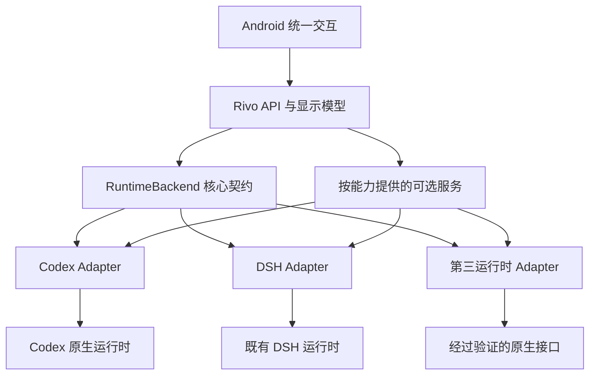

# 多运行时接入架构与迁移方案

本文是基于 Codex 与 DSH 接入验证形成的目标设计，尚未整体实现。第一批输入回执与能力声明，以及第二批会话状态、审批与恢复边界已落地，范围见下文。当前行为见[现有架构](architecture.md)；DSH 安装、能力边界和验证方式见[DSH 既有运行时接入](dsh-integration.md)。Claude Code 尚未接入，已核实的接口边界见[独立调查](claude-code-integration-boundaries.md)。

## 已实现的第一批契约

- [`receipts.py`](../server/rivo_relay/receipts.py) 定义输入接受和执行开始两种中立证据。新回执带 `kind / submissionId / threadId`；只有真实执行已开始才带 `executionId`。Codex 保留 `turnId`，DSH 保留 `requestId` 等旧字段供旧 APP 兼容。
- `SubmissionStore` 仅校验不可变身份与提交状态，调用 adapter 的 `recover_submission(record)` 核对。Codex 的 clientId 历史分页与 DSH 的持久 requestId 查询各自留在适配器。旧回执通过封闭兼容解码读取，不原地改写，不因升级重发。
- [`runtime_capabilities.py`](../server/rivo_relay/runtime_capabilities.py) 提供 `schemaVersion: 1`、`operations` 声明。每项含 `supported / available / reasonCode?`。节点与会话返回同一种格式；APP 的会话覆盖只能收紧节点能力。未知协议、未知操作和没有声明的后端拒绝操作；没有新声明的旧节点保留原 APP 兼容行为。
- 路由与提交准入使用相同的声明，输入选项和组合操作也检查对应能力；已接受的重复提交先返回原回执，能力变化不能把它重新发送。文件、媒体与 Sites 的旁路入口同样校验。适配器在实际操作时仍校验原生权限、请求代际和执行身份，展示声明不能代替这些检查。
- Codex 保留 released 会话可通过发送恢复、外部 writer 的有效原生问题可回答等已有语义；DSH 开放创建会话、文本发送、停止及审批，未实现的功能在 APP 收口并由服务端拒绝。
- 持久历史正在收敛且已有可信基线，不代表实时审批失效。断线后的同版本活动快照只有在失效之后发起、未被更新事件越过的新轮询中才能重新确认；旧详情回包与旧版本不能恢复可操作状态。

当前 HTTP 仍保留 `thread / turn / item` 兼容投影；本批没有改写聊天历史，也没有迁移所有路由的内部 connection 依赖。目标、队列、完整中立时间线与交互模型仍按后续阶段推进。历史草稿中的不支持设置会被保留并由服务端拒绝，不静默删除用户选择。

## 已实现的第二批契约

- [`runtime_state.py`](../server/rivo_relay/runtime_state.py) 定义 `sessionState`：会话身份、运行时代际、控制版本、执行状态、历史同步状态、控制权和 pending 交互。两适配器从自己的控制读取生成它，公共层不把后来读取的 generation 拼到旧审批上，也不把历史收敛当成实时授权。
- [`SessionService`](../server/rivo_relay/runtime_sessions.py) 承接列表、创建、读取、历史、发送、停止、活动与交互回应。公共聊天路由通过该边界调用后端，核心不读取 connection 或 writer。工作树、媒体、队列等可选服务仍有历史依赖；不能仅凭新增接口宣称所有路由已经解耦。
- 交互统一为 approval、questions、permissions、elicitation、unsupported。审批选项由适配器提供 opaque choiceId，映射到原生决策；请求 ID、revision 与 runtimeGeneration 一起绑定答复。实际执行仍由 Codex 原生交互管理器或 DSH bridge 的有效 key/代际/租约最终确认。
- 新回应端点返回 `mutation-applied`，完整绑定提交、会话和交互身份。回复丢失继续保持 unknown，只核对已有证据，不重新回答。旧 APP 的 requests/respond 保留兼容。
- `session/invalidated` 统一表达控制失效；APP 提升本地读取代际、清除可操作交互并重读权威快照，防止迟到回包复活审批。磁盘缓存不保存 pending 交互，APP 进程重启先显示缓存，再恢复读取与提交核对。
- 原生审批 I/O 在声明该请求的答复占用后释放 pending 锁再执行，避免与 writer 释放回调形成锁循环；实际 socket/RPC 发送仍核验代际。明确未发送的拒绝只有在原请求未失效、未换代、未被替换时才能恢复 pending。
- 网络重新可用时触发只读连通探测，即使上一轮离线探测已耗尽也能重新核验；它不重放业务提交，也不能直接把缓存恢复为可操作状态。
- Android 仍使用现有聊天和表单组件。新状态与交互协议异常时禁止操作；只有完全未声明新协议的旧节点走兼容分支。原生时间线、异步消息内问答、专有控制动作和 token 增量仍使用现有投影，本批没有统一所有消息块。

Claude 未来的 Channels 或自管 SDK 适配器可以独立实现会话与可选交互服务，不必模拟独占 writer 或编造 executionId。没有输入确认、远程审批或恢复证据时，分别声明不可用并保留 unknown，不能因为已有这套协议就声称 Claude 闭环已经成立。

## 判断与范围

保留 Android → Relay → 原生运行时的分层。扫码配对、节点凭据、HTTP/SSE、提交去重、草稿、待办与网络恢复适合由 Rivo 统一管理；原生会话、执行、权限和持久化继续由对应运行时负责。

需要重构的是 Relay 与运行时之间的契约。当前 DSH adapter 属于验证期的 **Codex 兼容投影**：它把 DSH 的会话事件映射成 `thread / turn / item`，让现有 APP 完成闭环。这能验证接入可行性，但不能把所有后端长期约束为 Codex 的执行模型。

本方案先服务于同一 APP 在 Codex、DSH 和未来第三类运行时之间保持一致的基本交互，不同时引入中央账号、跨节点任务调度或统一原生历史数据库。

## 当前耦合的代码证据

| 位置 | 现状 | 迁移方向 |
| --- | --- | --- |
| [`RelayApp`](../server/rivo_relay/app.py) | 已注入 backend，并通过 SessionService 提供核心会话入口；可选服务仍保留 codex 别名、隐式方法和可变 on_event 回调 | 继续明确可选服务及事件订阅生命周期 |
| [`threads` 路由](../server/rivo_relay/routes/threads.py) | 核心聊天已进入 SessionService；fork-context、workspaces 等可选路由仍访问 connection 或工作树对象 | 将剩余可选入口移入能力服务 |
| [`api.py`](../server/rivo_relay/api.py) | Sites 路由直接使用 Codex connection；文件处理依赖 Codex 模块 | 后端专有功能进入能力服务，通用传输工具独立出来 |
| [`routes/common.py`](../server/rivo_relay/routes/common.py) | 通用请求校验固定 Codex 的 sandbox、approvalPolicy、localImage、skill 等值 | 通用输入块与后端选项分离，按能力声明校验 |
| [`submissions.py`](../server/rivo_relay/submissions.py) | 已迁移到中立回执；运行时的恢复证据由适配器提供 | 保留旧持久回执兼容，继续验证第三适配器 |
| [`client_projection.py`](../server/rivo_relay/client_projection.py) | 直接处理 Codex `imageGeneration`、`commandExecution` 和 RPC 事件名 | 把现有实现保留为兼容投影，逐步引入中立显示模型 |
| [`MediaService`](../server/rivo_relay/media.py) | 读取 `.connection.generation`，使用 Codex 媒体命名与来源 | 依赖明确的资源能力、运行实例身份与资源版本 |
| [`DSH service`](../server/rivo_relay/dsh/service.py) | 大量非闭环操作返回 `_unsupported` | 不把这些空方法扩展为所有后端的必选协议 |

第一批已修正 `RelayApp.node()` 无条件声明 `todoAttachmentUpload` 和媒体能力的问题，改由实际操作声明计算。后续新增操作同样需要同时声明与实施服务端准入，不能只隐藏按钮而放任路由调用不存在的方法。

## 目标边界：小核心与可选服务

核心契约只覆盖最小聊天入口与其安全恢复：

| 核心领域 | 责任 |
| --- | --- |
| Lifecycle / Identity | 启动或附着适配连接、关闭连接、提供稳定运行实例身份与当前连接代际；不默认拥有或关闭原生进程 |
| Sessions | 列出、创建和读取会话；创建选项与当前可用性明确声明 |
| History | 读取最新显示快照与分页，返回 opaque cursor、revision 和一致性状态 |
| Inputs | 接收输入、提供接受回执、核对未知结果；保留提交身份与去重边界 |
| Events | 订阅标准化通知，声明代际、恢复方式及缺口；管理订阅生命周期 |
| Capabilities | 给出适用范围内的支持状态、当前可用状态、限制和选项 |

取消、转向、继续执行、审批、用户提问、模型选择、文件、工作区、Git、工作树、目标、调度、用量和 Sites 都属于可选服务。服务不存在时，统一路由返回可识别的“不支持”；服务存在但当前不可用时，返回原因和必要的重新校准条件。

协议应有类型明确的参数和结果，可先用 Python `Protocol`、dataclass 或 TypedDict 实现。不要用无类型的 `invoke(method, params)` 代替契约，也不要要求每个后端实现几十个永远抛出“不支持”的方法。

## 身份隔离

身份层次为 `nodeId → runtimeId → sessionId`：

- `nodeId` 标识 Rivo 节点；配对凭据与网络路由继续属于节点授权域。
- `runtimeId` 标识节点上的稳定运行实例或配置档，不等于产品名称 `codex / dsh / claude`，也不随重连变化。
- `sessionId` 在其原生运行实例内解释；相同字符串在不同实例中不能视为同一会话。
- `generation` 是连接或宿主生命周期标识，用于拒绝旧事件、旧审批和过时控制快照，不能作为稳定缓存目录身份。
- timeline block、输入回执、附件、审批和提交都携带或继承完整作用域。

当前一个 Relay 节点对应一个运行时的部署可以继续，`runtimeId` 可在此模式下唯一确定。未来同一节点挂多个运行实例时，扫码与节点选择需明确默认目标，后续提交固定到该目标；不可因某个运行时断线自动切换到另一个运行时发送同一输入。

草稿、历史显示缓存、未核对提交、媒体缓存和提醒按上述身份隔离。兼容迁移需显式映射已有节点的默认运行实例，不能仅通过会话 ID 猜测归属。

## 四类通用模型

### 1. 输入接受回执

把传输是否成功、输入是否被接受、执行是否开始和执行是否完成分开。建议回执使用后端无关的判别字段：

| 回执类型 | 必须证明的事实 | 可选关联 |
| --- | --- | --- |
| `input-accepted` | 指定 submissionId 对应的输入已被目标会话接受 | 原生 inputId、requestId；持久性和核对方式 |
| `execution-started` | 已有真实执行身份，并与本次输入建立了经过验证的关联 | executionId、输入身份 |
| `mutation-applied` | 指定会话、审批或设置变更已由权威服务接受或应用，语义由操作声明 | interactionId、资源版本等 |

公共部分包含 `submissionId`、`sessionRef` 和 `kind`。只有原生已提供并可验证时才携带 executionId，不能为排队中的 DSH 输入编造 turnId。产品类型仅用于标识来源，不参与存储层的接受规则。

`unknown` 是独立状态。跨 Relay SQLite 与原生运行时不承诺 exactly-once；原生回执丢失后由 adapter 的 `reconcile` 提供正证据、明确未提交证据或“仍未知”。通用层不扫描具体运行时的历史结构，不按正文匹配，不按超时推断可以重发。

DSH 原型的 `runtime: dsh / acceptance: input / requestId` 和既有 Codex turn 回执已通过兼容解码接入中立模型，新提交优先解析 `kind`。产品专有兼容字段不决定新契约的接受状态。

### 2. 能力与当前可用性

能力声明区分三件事：后端是否实现、当前会话是否允许、接受哪些具体选项。可以采用 operation → descriptor 的结构，例如含 `supported`、`available`、`reasonCode`、`choices` 与约束。

声明按节点、运行实例、会话分层。只读历史可用不等于会话可写；能显示附件不等于允许上传；支持一次性审批不等于支持整个会话授权。断线后显示缓存可以保留，但写能力必须失效。

同一份声明同时用于 APP 展示、服务端参数校验和路由准入。未知能力默认不开放。配置入口统一样式，但模型、推理等级、权限预设和合法值由对应后端提供，不把 Codex 的枚举值当成所有后端的定义。

### 3. 时间线、历史与事件

时间线使用 message、reasoning、tool activity、attachment、notice 等显示块，每个块有稳定 blockId、状态、来源和可选执行分组。消息可含多个内容块，工具可保留类型明确的详情及通用文本回退；不认识的内容不能静默消失或默认成功。

executionId 和分组不是所有运行时的前提。没有 turn 概念的后端也能显示消息与活动；不能通过“一个输入必然对应一个 turn”计算输入接受、取消目标或任务完成。

事件信封包含 runtimeRef、generation、sessionRef 与游标，内容可为文本增量、块变更、执行状态、交互打开/关闭或失效通知。实时流和持久日志分开：一次失败尝试可以保留已输出内容，但不能冒充完整成功消息。

历史 API 返回权威快照、opaque page token、revision 和 `ready / stale / unavailable` 等一致性状态。后端解释自己的 cursor 与 revision；Relay SSE epoch/cursor 独立存在。快照与事件并发时必须核对作用域、代际、历史版本和控制版本，不能让旧分页恢复旧审批或可操作状态。

Codex rollout、DSH Session 日志、压缩与替换规则均由各自 adapter 负责。Rivo 的展示缓存不成为第二份权威聊天历史。DSH 原型为验证投影而整段读取最多 64 页、64 MiB；正式接入阶段应采用适合 DSH 的增量分页，而非将这个上限读取方式变成统一算法。

### 4. 交互请求与审批

统一交互容器包含 interactionId、会话作用域、generation、标题、操作上下文、过期状态和可选答复。APP 统一布局，选择值使用后端提供的 opaque choiceId。

适配器负责把用户选择映射为原生答复，明确一次性、会话级或其他作用范围。不能从按钮文案推断权限，也不能给没有该能力的运行时自动加上“本会话允许”。工具审批应携带实际命令或参数上下文，用户提问、表单与浏览器确认等保留各自语义。

审批请求绑定真实生命周期；断线、取消、被另一端回答或权限归属变化后旧 key 失效。Rivo 配对认证并不替代原生审批，后端之间也不共享审批凭据。

## 不统一的原生语义

这些差异通过能力和适配器表达，不能通过重命名抹平：

- Codex 的独立 writer、OS 锁、释放和进程级接管；DSH 既有共享运行时的操作归属。统一“可执行哪些动作”，不统一成一套 writer 生命周期。
- 各后端 sandbox、权限预设、审批策略和凭据作用域。统一展示入口，不宣称同名权限等价。
- 输入接受、排队、执行分组及其关联；取消必须绑定原生可核验的执行身份或后端提供的等价并发条件。
- 历史分叉、恢复、压缩、重写、持久化检查及错误修复。
- project、workspace 与 cwd：工作区目录服务是可选能力。没有项目目录的后端可以展示“会话”入口，不能为了契约凭空创建一个原生项目。
- 后端专有工具与产品操作：通用回退可展示未知内容，但实际操作仍需能力实现，不能借通用入口绕过原生约束。

## 用第三个适配器验证扩展性

Claude Code 是未来候选后端。选择连接方式前必须核实当时实际可用的官方接口、认证、会话归属、审批和恢复行为；本方案不预设这些事实。

先创建第三种合成 `RuntimeBackend` fixture 来验证架构，不能用它宣称 Claude Code 兼容。fixture 至少覆盖：

1. 接受输入后暂时没有 executionId；一个执行可以接纳多个输入。
2. 没有原生 project、turn 或独占 writer；基础会话聊天仍能使用统一界面。
3. 不支持远程审批、模型选择、文件或取消等部分能力；APP 与 API 都拒绝不支持的动作，核心对象无需空方法补齐。
4. 有实时流但没有流事件重放；断线后清除暂态、重新读取权威快照。
5. 回执丢失且原生没有可核对的请求身份；结果保持未知，不重复发送。
6. 具有未知工具块、历史附件和失败尝试；显示可理解的回退，不丢内容、不伪造成功。
7. 运行实例与会话 ID 字符串冲突、旧 generation 的迟到回包；缓存、审批与提交仍隔离。
8. 能力在会话运行中变化；服务端准入与 APP 按钮保持一致，过期能力不能授权写操作。

验收标准：新增这个 fixture 或未来真实 adapter 时，不修改 SubmissionStore 的产品分支、不让 routes 读取 adapter 内部 connection、不在通用聊天页面新增后端名称判断。确有新的用户可见能力时可以扩展标准服务或显示块，但不能把某个后端的全部协议透传给 APP。

## 渐进迁移与兼容

### 阶段一：固化闭环并建立契约

保留当前 Codex／DSH 闭环和现有 HTTP 格式。新增中立的数据类型、BackendError、能力服务协议和契约测试。把原生回执核对移入 adapter；异常区分明确拒绝与可能已经提交。解决能力声明与实际实现不一致的问题。

现有 `thread / turn / item` 输出明确标记为兼容投影，不立即重写全部 Android 页面。

### 阶段二：两个真实后端都经过边界

组装入口负责选择 adapter、配置和后台任务。通用 routes、app、media、queue 不再读取 `.connection`、writer 或原生工作树对象。Codex 专有行为移入可选服务，文件范围解析、传输和媒体身份明确依赖资源能力。

同一套契约测试跑 Codex、DSH 和第三 fixture；保留各适配器的原生协议回归。不能仅靠改名为 `backend` 宣称完成解耦。

### 阶段三：迁移 APP 显示与操作协议

在明确的协议版本协商下提供中立 timeline、interaction、receipt 和 capability 模型；旧 APP 仍使用兼容投影，新 APP 通过同一套组件展示后端支持的动作。

优先迁移聊天、审批、停止和重连，再迁移文件、模型、目标等可选功能。每阶段保持原有节点配对、缓存隔离和未核对提交可恢复；不以迁移为由重发任务、重建原生历史或扩大权限。

### 阶段四：接入第三真实运行时

先验证 Claude Code 当时的实际接口，再实现独立 adapter 和必要的本机桥组件。至少复测扫码授权、既有会话、文本输入、真实审批或明确的本机处理边界、取消适用范围和断线恢复。没有验证的能力保持不可用，不根据相似产品推断支持。

## 验证与完成边界

每个阶段使用最小有效验证：通用契约测试证明模型和错误处理，adapter 测试证明协议转换，真实运行时验证证明附着与并发语义，Android 真机或模拟器验证证明交互可用。它们不能互相替代。

重构不自动包含提交、发布、运行时升级或迁移所有历史。实现完成的判断以两个真实后端和第三 fixture 的契约验收、现有 Codex 回归以及明确记录的 APP 验证范围为准。
